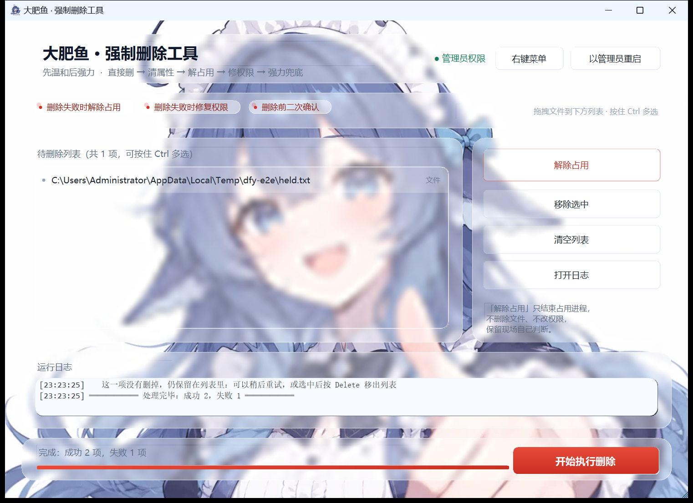
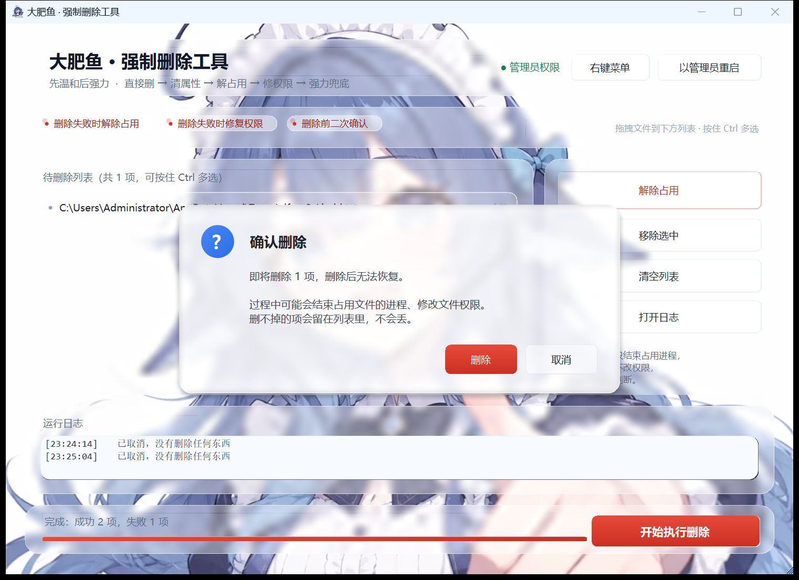

# 大肥鱼 · 强制删除工具

> 基于 [ccysb/CC-DEL](https://github.com/ccysb/CC-DEL) 的毛玻璃美化版。单文件、免安装、无外部依赖，专治 Windows 上「文件正在使用中 / 拒绝访问 / 找不到该项目」这类删不掉的文件和文件夹。



## 下载与运行

到 [Releases](../../releases) 下载 `DaFeiYu-ForceDelete-v1.1.1.exe`，双击即可运行，不需要安装。文件名可以随意改，不影响功能。

- 系统要求：Windows 10 / 11，自带 .NET Framework 4.x 与 PowerShell 5.1，无需额外安装
- 单文件约 1.5 MB，脚本、界面、图标、背景图全部内嵌
- 运行时会把资源释放到 `%LOCALAPPDATA%\DeepSeek\`，不写系统目录、不改 HKLM
- 普通权限即可运行；删除系统目录里的东西时，点右上角「以管理员重启」
- 没有数字签名，首次运行若出现 SmartScreen 提示，点「更多信息 → 仍要运行」

> **删除不进回收站，删了就没了。** 请先确认列表里的每一项，再点「开始执行删除」。

## 功能

- **渐进式删除**：直接删 → 清除只读/隐藏/系统属性 → 解除占用 → 修复权限 → 强力兜底 → 重启后删除。能在前一步解决就不动权限
- **解除占用**：用系统自带的 Restart Manager 找出是谁锁着文件；可以只结束占用进程、不删文件
- **长路径与保留名**：支持超过 260 字符的路径，也能删掉 `nul` 这类保留名文件
- **拖拽加入**：把文件或文件夹拖进窗口即可，支持 Ctrl 多选；选中后按 Delete 可移除
- **右键菜单**：安装后在资源管理器里右键就能把目标加入待删除列表；程序之后被移动或改名，下次启动会自动把菜单改指向新位置
- **接续旧版列表**：第一次运行时自动迁移原版 CC-DEL、WinDel 留下的待删除列表
- **实时日志**：每一步做了什么、失败在哪，都写进日志，可一键打开
- **出错自动恢复**：按钮操作或后台刷新出了意外，界面会恢复成可操作状态并写日志，不会卡在「处理中」
- **失败项可移除**：删不掉的项留在列表里，选中后按 Delete 或点「移除选中」即可移出（不删文件），也可以一键清空

## 界面

| 区域 | 作用 |
| --- | --- |
| 顶部 | 标题、当前权限、「右键菜单」安装/卸载、「以管理员重启」 |
| 选项 | 删除失败时解除占用、删除失败时修复权限、删除前二次确认（默认全开） |
| 待删除列表 | 半透明玻璃面板，显示完整路径，右侧标注文件 / 文件夹 |
| 右侧操作 | 解除占用、移除选中、清空列表、打开日志 |
| 运行日志 | 实时输出处理过程 |
| 底部 | 状态与进度条、「开始执行删除」 |

窗口默认 1000 × 700（逻辑像素），可自由缩放，高 DPI 下按比例放大。

提示框也是同一套毛玻璃风格：圆角、磨砂底、按类型配色的图标（询问蓝、警告黄、出错红），Enter 触发主按钮，Esc 触发取消。



## 命令行

```text
大肥鱼-强制删除工具.exe                  打开图形界面（已有窗口则激活它）
大肥鱼-强制删除工具.exe -Add "路径"      把路径加入待删除列表，不开新窗口
大肥鱼-强制删除工具.exe -Install         安装资源管理器右键菜单
大肥鱼-强制删除工具.exe -Uninstall       卸载右键菜单
大肥鱼-强制删除工具.exe -Probe "路径"    只查不删：是谁占用了它
大肥鱼-强制删除工具.exe -Pending "路径"  登记为下次开机时由系统删除
大肥鱼-强制删除工具.exe -SelfTest        自检（26 项）
```

（Release 里的文件名是 `DaFeiYu-ForceDelete-v1.1.1.exe`，下面以自己构建出的文件名举例。）

也可以不编译直接跑脚本：`powershell -ExecutionPolicy Bypass -File src\DeepSeek.ps1`。脚本需要和 `DeepSeek.Ui.cs`、`logo.ico`、`bg.png` 放在同一目录。

## 从源码构建

只需要 Windows 自带的 PowerShell 5.1 和 .NET Framework，不用装 Go、Visual Studio 或任何 SDK：

```powershell
powershell -ExecutionPolicy Bypass -File build.ps1
```

产物在 `dist\大肥鱼-强制删除工具.exe`。构建脚本会检查 exe 的子系统是不是 GUI（防止闪黑窗）、四个资源是否都已内嵌、文件属性里的名称与版本是否正确。构建前还会先解析脚本语法、扫描把 `true` / `false` / `null` 当成命令执行的写法，有问题直接中止。

## 目录结构

```text
.
├─ build.ps1              构建脚本（csc.exe 编译）
├─ src\
│  ├─ launcher.cs         C# 宿主：释放资源、无黑窗拉起 PowerShell、单实例
│  ├─ DeepSeek.ps1        主脚本：删除引擎 + 图形界面（内部代号 DeepSeek）
│  ├─ DeepSeek.Ui.cs      界面控件与毛玻璃绘制
│  ├─ app.manifest        清单：DPI 感知
│  ├─ AssemblyInfo.cs     文件属性里的名称、版本、版权
│  ├─ logo.ico            程序图标
│  └─ bg.png              界面背景图
├─ assets\icon.png        图标源图
├─ docs\                  截图
└─ upstream\              原版 CC-DEL 的脚本、README、LICENSE，仅供对照
```

## 相对原版 CC-DEL 的改动

- 图形界面重写为毛玻璃风格：每个面板独立绘制自己区域的模糊背景取样，列表半透明
- 自定义背景图与程序图标
- 宿主程序由 Go 改为 C#（`launcher.cs`），用系统自带的 `csc.exe` 即可编译
- 窗口默认尺寸调整为 1000 × 700
- 删除引擎（`Invoke-ForceDelete`、`Unlock-Target` 等）的删除逻辑没有改动，只把其中的询问框换成了毛玻璃提示框

## v1.1.1 修复的问题

v1.0.0 起，「开始执行删除」按钮的点击事件里混进了一行 C# 写法（`$ok = false`）。PowerShell 会把 `false` 当成命令去执行，直接报错。后果是：一点「开始执行删除」就弹出系统的异常框，界面从此停在「处理中」，所有按钮都没反应。这个问题从 v1.0.0 就在，v1.1.0 也没发现，直到实际使用才暴露。

- **「开始执行删除」可以用了**：改掉那行写法。整条流程（确认删除 → 解除占用 → 需重启删除 → 处理完毕）用真实鼠标逐个按钮点过，删得掉的删掉，删不掉的留在列表里
- **提示框统一为毛玻璃风格**：确认删除、解除占用询问、是否登记重启后删除、处理完毕、出错提示等，全部换成与主界面一致的圆角毛玻璃框，带图标和配色（询问蓝、警告黄、出错红）；Enter 触发主按钮，Esc 触发取消。粗糙的系统异常框不再出现
- **失败项可以移除了**：处理结束后留在列表里的失败项，选中后按 Delete 或点「移除选中」即可移出（只移出列表，不删文件），也可以一键「清空列表」；列表为空时点「开始执行删除」会直接提示
- **出错后界面自动恢复**：按钮操作或后台刷新抛出异常，都会写日志、把界面恢复成可操作状态，再弹窗告知（可一键打开日志），不会再永久卡住
- **处理中关窗口会先询问**：正在删除时点关闭，会问「继续等待 / 仍然退出」；选继续等待回到处理中，选仍然退出则停止本次处理后再关
- **自检从 19 项增加到 26 项**：新增「没有把 true/false/null 当命令执行」、引擎与批量删除的返回值和回调、不存在的目标与删不掉的目标各自的处理方式
- **构建脚本多两道前置检查**：构建前先解析脚本语法，再扫描把 `true` / `false` / `null` 当成命令执行的地方，就是这次出问题的写法。以后再写错，会在构建阶段被拦下

## v1.1.0 修复的问题

通读代码后逐项处理，按来源分开列，方便对照。

**原版 CC-DEL 就有的：**

- **系统工具改用完整路径**：原版直接按名字调用 `takeown`、`icacls`、`robocopy`、`attrib`。从 PATH 被精简的环境启动时（部分终端、启动器、计划任务），这些命令找不到，「修复权限」和「强力兜底」两步会不报错地跳过。已在自检中复现（19 项里失败 1 项），现在固定从 `%SystemRoot%\System32` 调用，同一环境下 19 项全过
- **同时加入不再丢项**：多个进程同时往待删除列表里写（比如连续右键添加多个文件）时，原版是「读—改—写」，互相覆盖会丢条目。现在用命名互斥体串行写入，实测 10 个进程同时加入，列表恰好 10 项

**v1.0.0 美化版自身的：**

- 命令行模式（`-Install`、`-Probe` 等）原先先读完标准输出再读错误输出，输出一多可能互相等待；改为错误输出走独立线程
- 对话框标题显示的是内部代号，改为软件名
- 待删除列表的迁移补上更早的 WinDel 版本（原先只认 CC-DEL）
- 安装右键菜单时会一并清掉原版 CC-DEL 与 WinDel 留下的旧菜单，避免出现两条
- exe 文件属性里的名称、版本、版权不再空白

**加固：**

- 首次启动时如果有多个实例同时释放内嵌资源，写文件带重试与校验，避免读到写了一半的文件
- 列表选中项可按 Delete 移除；「右键菜单」按钮安装或卸载后会弹窗告知结果

## 注意事项

- 「解除占用」会结束正在使用目标的进程，未保存的工作会丢失
- 「修复权限」仅在直接删除失败时才会执行，会对目标执行 `takeown` 与 `icacls`
- 被已加载的 DLL 锁住的文件（映像锁定）通常重启前删不掉，可以用 `-Pending` 登记为开机时删除
- 日志在 `%LOCALAPPDATA%\DeepSeek\DeepSeek.log`

## 许可证与致谢

本项目基于 [ccysb/CC-DEL](https://github.com/ccysb/CC-DEL)（MIT License, Copyright (c) 2026 pcoof）修改，原版许可证全文见 [LICENSE](LICENSE) 与 [upstream/LICENSE](upstream/LICENSE)。

「DeepSeek」仅为本项目内部脚本与数据目录的代号，与 DeepSeek 公司无关，本项目未获其背书。
